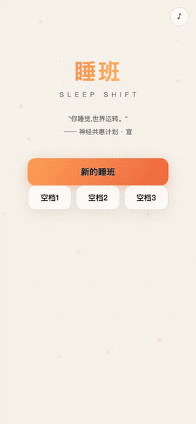
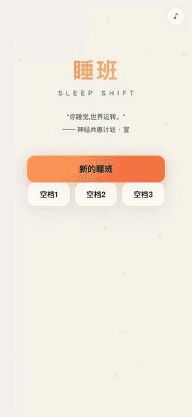
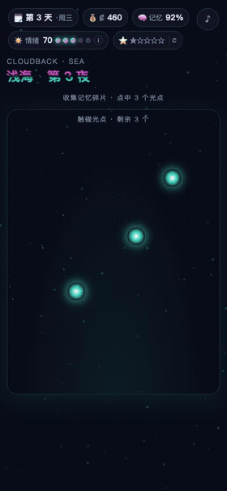
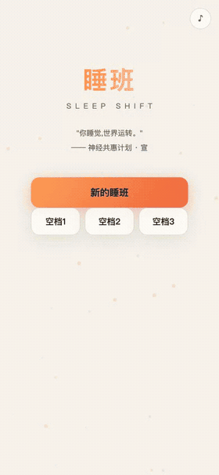

# 睡班 · Sleep Shift

> “你睡觉，世界运转。”
>
> 2087 年，常暖市。人类不再为了工作而睡觉，而是为了睡觉，而活着。

一款发生在生物算力矿场里的叙事向睡班模拟器。白天接单，夜里把自己的脑子接进算力池；天亮后结算突触秒、矿池分成和记忆损耗。三十天试用期结束后，你要决定自己还剩下多少。

**[▶ 在线游玩](https://jsjm1986.github.io/sleep-shift/)**


<table align="center">
  <tr>
    <td align="center"><br><sub>标题 / 序章</sub></td>
    <td align="center"><br><sub>白天 · 接单</sub></td>
  </tr>
  <tr>
    <td align="center"><br><sub>夜班 · 云背净化</sub></td>
    <td align="center"><br><sub>大清算 · 自动签收</sub></td>
  </tr>
</table>

## 这是什么

你是常暖市的一名试用期供体，编号 3409-02。合同写着“自愿出租睡眠时段大脑算力”，供体舱里的人把这份工作叫“上矿”。

- **白天**：在六种睡班合同里选一单。标注、渲染、共作、折叠、金融、黑单，产出、污染风险、情绪代价都写在卡面上。
- **夜里**：进入云背。收集记忆碎片，按住并拖动净化污染体，处理那些从你记忆里长出来的东西。
- **天亮**：结算本夜产出多少突触秒、矿池分成多少、数据质量扣了多少。
- **每周**：大清算。租金、梦税、机架维护、神经磨损，一笔一笔从你账上划走；评级也跟着升降。
- **第三十天**：你要在“醒来”“留下”“把名字还给自己”之间做一次选择。

## 核心循环

```text
选合同 → 生活行动 → 开始睡班 → 云背玩法 → 天亮结算
   ↑                                      ↓
   └──────── 周清算 / 评级 / 记忆 ────────┘
```

三十天，六种合同，三条路线，十三处真相，多个结局。没有随机掉宝，也没有抽卡；每一次“多赚一点”，都对应一个具体的代价。

## 一些不一样的地方

**算力账本是可算的。** 每夜产出 0.91–3.40×10⁹ 突触秒，公开牌价 ₡793 / 1×10⁹。结算单会同时写：你到手多少、池子留下多少、抽成比例多少。终局会把三十天的总账算给你看。

**评级真的会挡钱。** 高负载单有评级门槛，黑单不看评级——它根本不在册上。评级会在每周大清算和云梯塔超频会上变动。

**记忆、情绪、污染都会进入结算。** 情绪是散热，记忆是折旧，污染体是残留。数据质量最低封顶 0.8，避免“越难受越赚不到、越赚不到越难受”的死亡螺旋。

**没有服务器。** 纯静态 HTML/CSS/JS + Canvas 2D，存档在浏览器 `localStorage`，打开网页就能玩。

## 操作

- 点击 / 轻触：推进对话、选择合同、收集碎片
- 按住并拖动：净化污染体；它逃逸后重新按住
- 手机浏览器可直接玩；音频需要先点一下页面才会出声
- 存档按浏览器保存，换设备不会同步

## 本地运行

不需要安装依赖，也不需要构建。

```bash
git clone https://github.com/jsjm1986/sleep-shift.git
cd sleep-shift
python3 -m http.server 8765
```

打开 <http://127.0.0.1:8765>。

也可以直接双击 `index.html`；如果浏览器对本地文件限制较多，用上面的本地服务器更稳。

## 项目结构

```text
index.html              入口
css/style.css           全部样式与动画
js/data_actions.js      合同、生活行动、价目
js/data_days_*.js       30 天日程与剧情
js/data_stories.js      支线、角色、结局
js/data_work.js         工单与夜班蒙太奇
js/data_world.js        世界观、消费链、年表、公共屏幕
js/scene_art.js         Canvas 场景
js/main.js              引擎、UI、存档、结算
docs/gifs/              README 用的 GIF
screenshots/            开发过程截图
设计文档.md              系统设计与数值约定
审查报告.md              逐轮实测、缺陷与修复记录
```

## 文档

- [设计文档](设计文档.md)：系统结构、数值口径、叙事约束
- [审查报告](审查报告.md)：真实浏览器通关、机制探针、UI 与可玩性审计

## 技术

- 原生 JavaScript，无框架、无打包、无 npm 依赖
- Canvas 2D 场景与粒子
- Web Audio 合成音效
- `localStorage` 存档
- GitHub Pages 静态托管

## 最后

如果这个项目让你想起某个睡不着的夜晚，点个 Star。

---

设计 / 代码 / 文本：[jsjm1986](https://github.com/jsjm1986)
